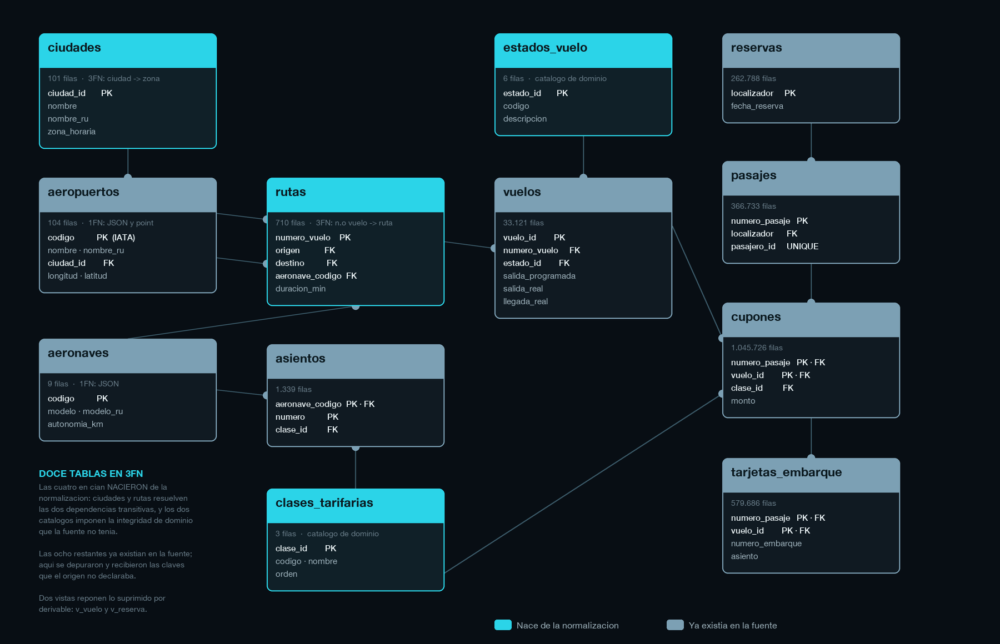
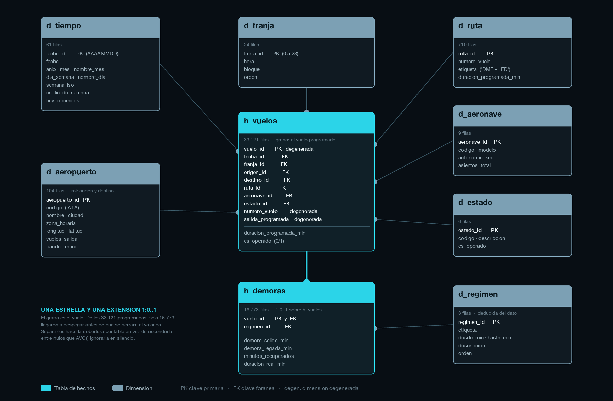

# Concentración del retraso en una red aérea doméstica (julio–agosto de 2017)

Investigación estadística descriptiva sobre los **16.773 vuelos operados** de una
red aérea doméstica de **104 aeropuertos**, durante los 31 días en que la fuente
registra horas reales de salida.

> **Estado del trabajo.** En curso. Este documento se actualiza a medida que
> avanza la investigación: las secciones de resultados, el enlace al aplicativo
> y el enlace al tablero se incorporan cuando cada etapa queda terminada y
> verificada.

---

## Planteamiento del problema

Cuando una red aérea acumula retraso, la explicación que se da por supuesta es
geográfica: hay aeropuertos que lo generan y lo propagan al resto. De ahí la
pregunta de partida —**¿dónde se concentra el retraso?**— y la expectativa de
encontrar unos pocos nodos responsables de buena parte del problema.

El perfilado previo de la fuente **no encuentra esa concentración**. Comparando,
para cada aeropuerto, su cuota de minutos de retraso con su cuota de vuelos:

| Aeropuerto | Ciudad | Vuelos | % de vuelos | % del retraso | Índice |
|---|---|---:|---:|---:|---:|
| DME | Moscú | 1.626 | 9,69 % | 9,75 % | **1,006** |
| SVO | Moscú | 1.510 | 9,00 % | 8,87 % | **0,986** |
| LED | San Petersburgo | 960 | 5,72 % | 5,89 % | **1,030** |
| VKO | Moscú | 870 | 5,19 % | 5,68 % | **1,095** |

Un índice de 1 significa que el aeropuerto acumula exactamente el retraso que
explica su volumen. Los cuatro mayores están entre 0,99 y 1,10: **el retraso se
reparte en proporción al número de vuelos, y nada más**. Entre los 104
aeropuertos, el índice más alto es 1,35 y el más bajo 0,51.

El reparto tampoco es temporal. Los 800 vuelos de mayor retraso aparecen en
**los 31 días de operación sin excepción**, entre 18 y 37 cada día, y en **92 de
los 104 aeropuertos**. No hay jornadas de colapso ni nodos culpables.

### Dónde sí hay estructura

La estructura no está en la red: está en **la forma de la distribución**.

| Demora de salida | Vuelos | % |
|---|---:|---:|
| 0 minutos (puntual) | 717 | 4,27 % |
| 1 a 11 minutos | 15.256 | 90,96 % |
| **12 a 123 minutos** | **0** | **0,00 %** |
| 124 a 277 minutos | 800 | 4,77 % |

No hay **ni un solo vuelo** entre los 12 y los 123 minutos de demora. Son dos
poblaciones separadas, cada una con su propia forma: la baja culmina en los 2–3
minutos y se agota en los 11; la alta culmina entre los 180 y los 209 y llega
hasta los 277.

Y la consecuencia que ordena toda la investigación: **la demora media es de
12,21 minutos, un valor que cae dentro del hueco**. Ningún vuelo de la base
tiene la demora media. Resumir este fenómeno con un promedio no es una
simplificación aceptable: es describir algo que no existe.

### Una advertencia que no se puede omitir

Un hueco perfectamente vacío de 112 minutos, en 16.773 observaciones, no es un
comportamiento operativo plausible. Es casi con seguridad una huella de cómo se
generó esta base de demostración. El estudio **describe lo que el registro
dice** y usa esa estructura para mostrar por qué una media puede ser
engañosa; **no afirma** que así se comporte el retraso aéreo real. La distinción
se mantiene explícita en cada conclusión.

### Y la fuente, además, no se puede usar tal cual

`travel.sqlite` es el volcado de una base PostgreSQL de operación: ocho tablas,
**sin claves primarias, sin claves foráneas y sin índices**, con campos
bilingües en `jsonb`, coordenadas en un tipo `point`, **16.348 nulos escritos
como la cadena literal `\N`** y marcas de tiempo con un desplazamiento horario
que SQLite no sabe interpretar. Antes de describir nada hay que reconstruir el
modelo.

---

## Objetivo general

Describir, con herramientas de estadística descriptiva, **cómo se distribuye el
retraso** en una red aérea doméstica durante el verano de 2017, separando lo que
explica el volumen de operación de lo que no, y caracterizando la **forma** de
la distribución en lugar de resumirla con una medida de posición que no
describe a ningún vuelo.

---

## Objetivos específicos

1. **Reconstruir el modelo de datos.** Normalizar la fuente hasta la tercera
   forma normal —resolver los campos multivaluados, depurar los nulos
   textuales, corregir el formato de las fechas y declarar las claves que la
   fuente omite— y derivar de ella el esquema dimensional que alimenta el
   aplicativo y el tablero. *(Etapa cumplida:
   [NORMALIZACION.md](Base%20de%20datos/NORMALIZACION.md) y
   [DENORMALIZACION.md](Base%20de%20datos/DENORMALIZACION.md).)*

2. **Delimitar el universo observable.** Determinar cuáles de los 33.121 vuelos
   programados tienen hora real de salida y por qué los demás no la tienen,
   dejando la cobertura del registro como un resultado y no como un filtro
   silencioso.

3. **Caracterizar la distribución de la demora.** Construir sus tablas de
   frecuencias y sus medidas de posición y dispersión, y evaluar de forma
   explícita si la media y la desviación típica son resúmenes admisibles para
   una distribución con dos modas separadas.

4. **Medir la concentración en la red.** Contrastar, para cada aeropuerto y
   cada ruta, la cuota de minutos de retraso frente a la cuota de vuelos, y
   determinar qué parte de la desigualdad observada queda explicada por el
   volumen de operación.

5. **Describir el reparto temporal.** Examinar el comportamiento por franja
   horaria, día de la semana y día de operación, y comprobar si existe algún
   patrón que la proporcionalidad con el volumen no explique.

6. **Caracterizar la población de retraso alto.** Describir los 800 vuelos del
   modo superior y contrastar si se distinguen del resto por aeropuerto, ruta,
   aeronave, franja horaria o día; y declarar con claridad qué parte de su
   comportamiento la fuente **no** permite explicar.

7. **Publicar los resultados.** Disponer un aplicativo interactivo en Streamlit
   y un tablero en Tableau Public que permitan recorrer la investigación
   completa y consultar la base directamente.

---

## El modelo de datos

La fuente pasa por dos transformaciones. La primera la **normaliza hasta
tercera forma normal**, declarando las claves que el volcado no traía y
resolviendo las dos dependencias transitivas que se verificaron sobre los
datos:



La segunda deriva de ella el **esquema en estrella** que alimenta el aplicativo
y el tablero:



El grano es el vuelo. `h_vuelos` carga los 33.121 programados y `h_demoras`,
en relación 1:0..1, sólo los 16.773 que llegaron a despegar: así la cobertura
del registro queda contable en vez de escondida entre nulos. El detalle está en
[DENORMALIZACION.md](Base%20de%20datos/DENORMALIZACION.md).

---

## Estructura del repositorio

```
assets/
  banner_retraso.png       Cabecera, con su script generador
  esquema_normalizado.png  Diagrama del esquema en 3FN, con su generador
  esquema_estrella.png     Diagrama del modelo dimensional, con su generador
Base de datos/
  normalizacion.sql      travel.sqlite       ->  travel_normalizada.sqlite
  NORMALIZACION.md       El proceso, decisión por decisión
  denormalizacion.sql    travel_normalizada  ->  travel_analitica.sqlite
  DENORMALIZACION.md     El esquema en estrella, dimensión por dimensión
  conversion_duckdb.sql  travel_analitica.sqlite  ->  travel_analitica.duckdb
  CONVERSION_DUCKDB.md   Por qué DuckDB, y qué cuesta
```

Las etapas siguientes —modelo dimensional, explotación analítica, aplicativo y
tablero— irán añadiendo sus propias carpetas a medida que se completen.

Ninguna base de datos se versiona: pesan 104 MB, 186 MB, 5 MB y 7,5 MB, y las
tres derivadas se reconstruyen con los scripts.

---

## Replicación

```bash
git clone https://github.com/Olivertc24/Analisis-Concentracion-del-Retraso-en-la-Red-Aerea-Domestica-2017.git
cd Analisis-Concentracion-del-Retraso-en-la-Red-Aerea-Domestica-2017
```

Se coloca `travel.sqlite` en `Base de datos/` —pesa 104 MB, por eso no se
versiona— y se ejecutan los scripts de esa carpeta en orden. Cada etapa del
trabajo añade el suyo y lo documenta junto a él.

```bash
cd "Base de datos"
sqlite3 travel_normalizada.sqlite < normalizacion.sql
sqlite3 travel_analitica.sqlite   < denormalizacion.sql
duckdb  travel_analitica.duckdb   < conversion_duckdb.sql
```

Tardan **2,3 segundos**, **1** y **0,2** respectivamente. Todo el proceso de
datos se reproduce con dos clientes de línea de comandos y **ningún lenguaje de
programación**: ni Python, ni dependencias, ni servicios externos.

Los dos primeros pasos bastan para tener el esquema en estrella completo; el
tercero sólo hace falta para disponer del repertorio estadístico que el
objetivo 3 necesita.

---

## Fuente

Base demo *Airlines* de Postgres Pro, volcada a SQLite: 33.121 vuelos
programados entre el 16 de julio y el 14 de septiembre de 2017, de los cuales
16.773 llegaron a despegar antes de que se congelara el volcado, el 15 de
agosto. Los demás seguían siendo futuro en ese momento.
